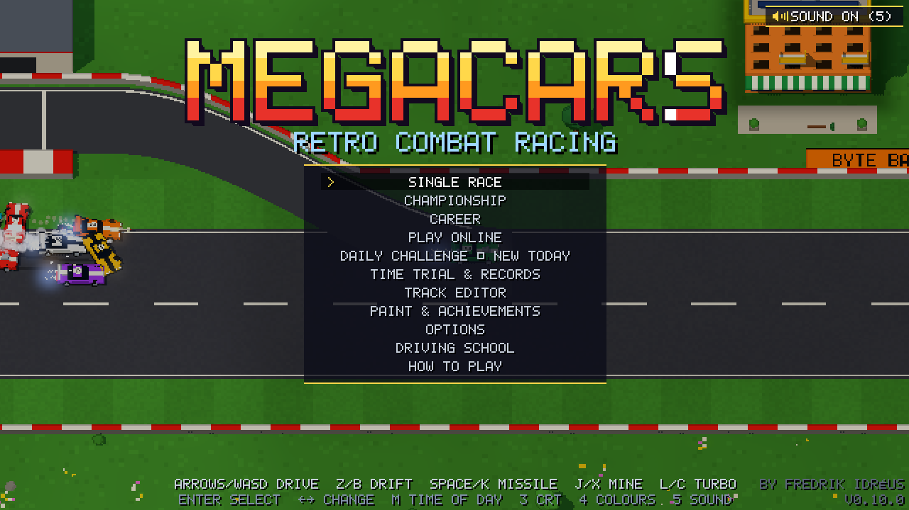
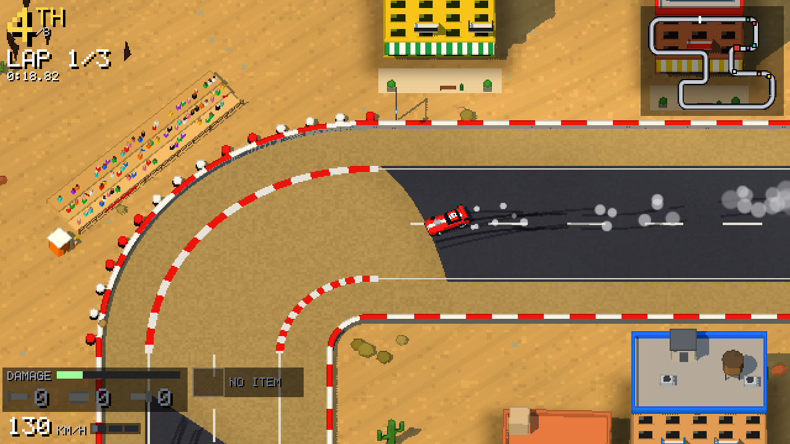
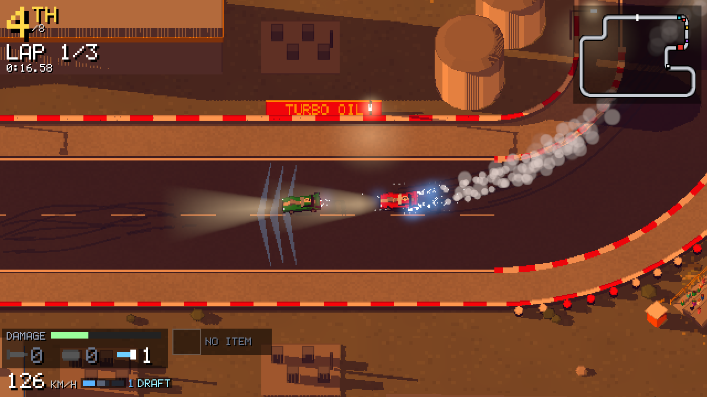
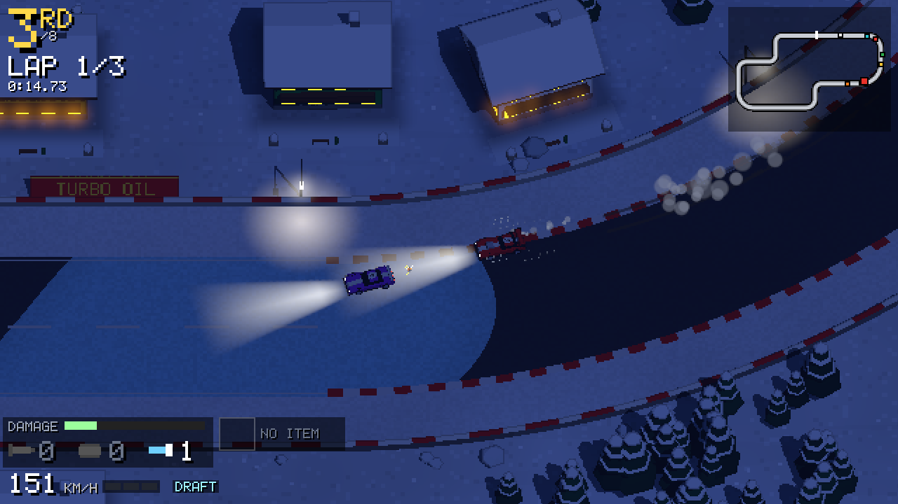
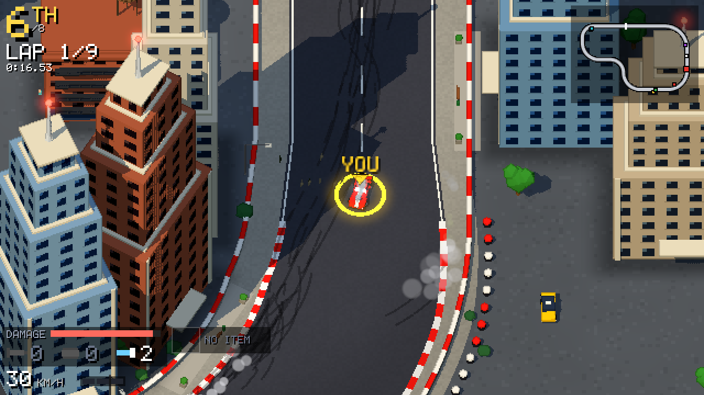
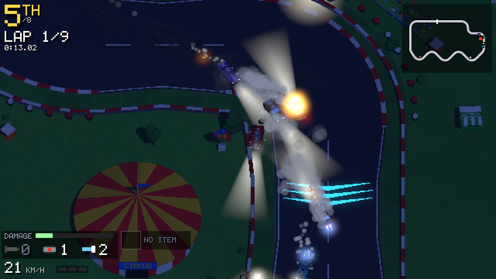
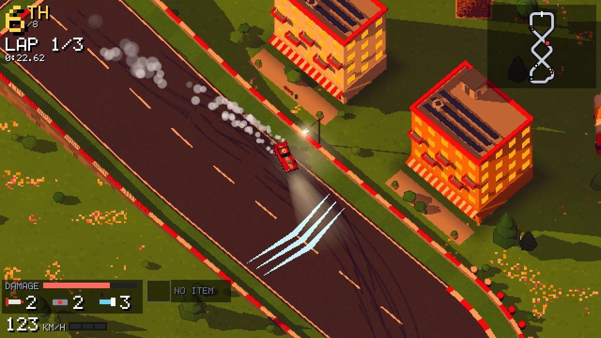
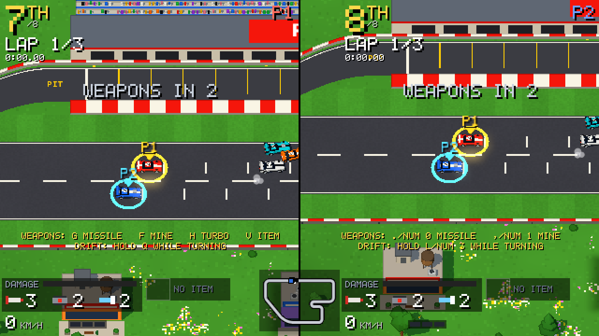
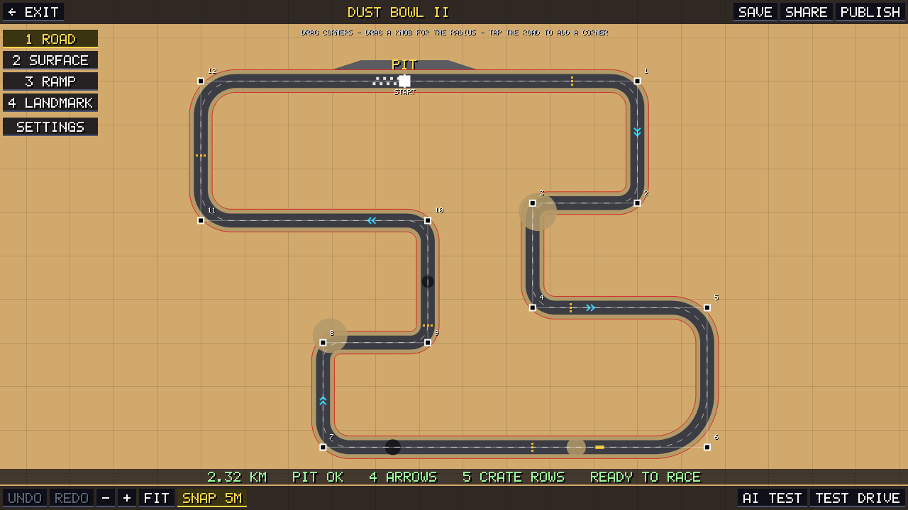

# Megacars

<p align="center">
  
</p>

<p align="center">
  <b>Retro top-down combat racing for the browser.</b><br>
  Drift, boost, fire missiles and drop mines – alone, in split screen or online with up to eight players.
</p>

<p align="center">
  <a href="LICENSE"></a>
  
  
</p>

Megacars is a top-down combat racer inspired by the Amiga classic Super Cars
II. It is 3D rendered at a low internal resolution (~360 lines) with a
pixel-snapped camera, a toon-shaded world, glossy cars, hard shadows, bloom
and optional Amiga colour modes/CRT. The physics are arcade drift physics:
full-speed corners are taken sideways.

- **Nine tracks** – countryside, desert, ice, a nuclear plant, a brewery, a
  funfair, tobacco country, Manhattan and a track that crosses itself twice,
  with jumps and bridges – with weather and day, sunset and night.
- **Drift boost, drafting, ramps and weapons:** missiles, mines, turbo and
  special items in crates on the track.
- **Single race, championship, career, elimination, time trial, daily
  challenge and a driving school**, with medals, achievements and paint jobs.
- **Split screen** for two players, **online rooms** for up to eight, and
  online leaderboards with replayable ghosts.
- **A track editor** – build your own tracks, share them as a link and
  publish them for others.
- **Tracker music** (MOD/XM/IT) played with libopenmpt; drop your own module
  files into the window to add them.
- Gamepad, keyboard and touch controls; installable as a PWA and playable
  offline against the AI.

## Screenshots

| | |
|:---:|:---:|
|  |  |
| **Dust Bowl** – narrow desert track | **Meltdown Ridge** at sunset |
|  |  |
| **Frost Ring** at night | **Manhattan Sprint** |
|  |  |
| **Tivoli Twist** – missiles at the funfair | **Brewery Bash** |
|  |  |
| Two-player **split screen** | The **track editor** |

## Getting started

```bash
npm install
npm run dev        # Vite (http://localhost:5173) + game server (ws on 8787)
npm test           # physics, track and drift benchmark tests
npm run typecheck
npm run build && npm start   # production: one server for game + WebSocket on $PORT
```

## Playing

The title menu is controlled with the arrow keys/WASD + Enter, a gamepad or
the mouse: start a race, 1–2 players (split screen), track, number of laps,
opponents, difficulty, time of day, or free practice. The race starts with
five red start lights – when they go out, it's flat out. After the finish the
results list is shown. Under **LEAGUE** you choose the car class:
**STANDARD** (the game as tuned), **SUPERCARS** (much faster, grips and
brakes harder) or **MEGACARS** (a bit faster again, with its own wilder
look). Each class has its own record boards per track.

The title menu: SINGLE RACE, CHAMPIONSHIP, CAREER, PLAY ONLINE, DAILY
CHALLENGE, TIME TRIAL & RECORDS, TRACK EDITOR, PAINT & ACHIEVEMENTS, OPTIONS,
DRIVING SCHOOL and HOW TO PLAY. It's kept short enough to fit on a small
phone without scrolling; on short screens the logo shrinks instead. Going
back from RECORDS, ACHIEVEMENTS and PAINT SHOP returns you to the page you
came from.

On tarmac the car grips up to the limit and then understeers – it doesn't
slide on its own. The easiest way to start a drift is the **drift button**
(Z, or LB on the gamepad) while you steer into the corner – hold it down and
the car holds the slide. You can also **lift off the throttle briefly (under
0.3 s) and get back on it** while steering into the corner – or dab the brake
(under 0.25 s) while steering. Coasting for longer or braking normally
doesn't start a drift. In a slide the tyres can take much more lateral force,
so good timing gets you through tight corners much faster. Throttle increases
the slide angle; lift off or countersteer to straighten up. Ice, oil and snow
make the car slide on their own.

**Drift boost:** sliding through a corner charges a boost in three levels,
after roughly 0.6, 1.3 and 2.2 seconds of drift (the meter next to the speed,
sparks from the rear wheels in blue, orange and purple). When the car grips
again it gets a short push forward: level 1 is a small puff (0.6 s), level 2
is longer and stronger (1.2 s), level 3 (a long hairpin on Cigar Circuit) is
a bit better than a turbo (2 s). As long as you hold the drift button through
a charged drift, the tyres scrub off only a quarter as much speed, so a long
clean drift pays off more than a short one: on twisty tracks with long
corners, holding the drift gains 1–3% of a lap over just flinging the car in.
It only counts while the car is actually turning, in a corner and just after
it; sliding or weaving down a straight gives no charge and no repair. Ice,
oil and snow charge nothing; a hard hit against a wall or a car, or a spin,
wipes the charge, and braking holds the boost back. The AI drivers charge and
get boost the same way (but they never hold the drift button, so they don't
get the reduced scrub).

**Draft:** if you sit close behind another car (from a few metres to about
24 m behind, going the same way and at speed) you get pulled along: up to 6%
higher top speed and a little more acceleration. The effect builds up over
0.7 s and fades over 0.3 s. DRAFT lights up next to the speed, air streams
past the car and it starts to whine. It doesn't apply during the countdown,
or behind wrecks or ghosted cars after a reset.

Nine tracks: **Green Valley** (wide countryside track), **Dust Bowl**
(desert, narrow and technical, gravel, oil patches and a jump over a dry
riverbed), **Frost Ring** (winter, fast sweepers with ice and packed snow),
**Meltdown Ridge** (through a nuclear power plant: cooling towers, reactor
halls, a coolant leak and a jump over the cooling-water canal – come up short
and you'll have to wade out), **Twin Bridges** (crosses itself twice: a
broken bridge to jump and a viaduct), **Brewery Bash** (brewery, beer on the
road), **Tivoli Twist** (compact funfair track with left-right flicks, raced
with three times as many laps), **Cigar Circuit** (compact track in tobacco
country with three hairpins in a row, pure 180° turns for long drifts, and
ash on the road) and **Manhattan Sprint** (compact New York track through a
block of high-rises with two long sweeping right-handers, a narrow side
street, wet tarmac, and Lady Liberty, the subway and taxis in the backdrop –
raced with three times as many laps).

New track? See `.claude/skills/new-track/SKILL.md` and `npm run track`.

**Ramps and jumps:** drive up the ramp and the car takes off – the faster,
the further. You can't steer in the air; a hard landing costs a little speed
(and a little damage when weapons are on). The AI drivers hold their lane up
to a jump and don't take off faster than they can brake for the corner after
the landing, so they don't fly crooked into the side wall.

**Weapons** (can be turned off in the menu and in the online lobby): every
car starts with 3 missiles, 2 mines and 2 turbos, and restocks from the
crates on the track. Missiles fly straight ahead and spin round whoever they
hit; mines are dropped behind the car, arm after half a second and throw the
car into the air. Turbo gives 1.5 s of extra power and a higher top speed.
Weapons unlock three seconds after the start. Collisions and hits cause
damage; above 40% damage the car slows down, and at 100% it explodes, burns
for a while and comes back patched up (60% damage) and can't be hit for
2.5 s, so it has time to get past the mines that often lie where it blew up.
The AI drivers use weapons too – more often the harder they are.

**Crates** (only with weapons on): in a few places around the lap, a row of
two or three glowing crates stands across the road, so you have to pick a
line. Drive through one and you get something: 2 missiles, 2 mines, 1 turbo
or a repair (30% damage). The crate comes back after 6 seconds. What it gives
is decided by the track (the seed, the crate and the tick), weighted a little
by position: cars at the back more often get turbo, missiles and repair, the
leader more often mines. The cap is the same as in the shop (12 missiles,
8 mines, 6 turbos); if you're full on something you get something else, and
if you're full on everything the crate stays for the next car. The HUD shows
what you got ("+2 MISSILES") above the weapon panel. The track builder places
the crates itself based on the track's shape – 3–5 rows on a normal track,
fewer on the short ones – never in the pit lane, on the starting grid, on
ramps, bridges or the landing after a jump, on the arrows or in the braking
zone before a tight corner. The AI drivers will happily steer a metre or two
off their line for a nearby crate, but never across the road. `npm run track`
and the track editor's status bar show the rows. New kinds of contents are
added as a row in `CRATE_ITEMS` in `src/shared/sim/crates.ts`.

**Special weapons** (only with weapons on): on top of the ammo, the car has a
**special slot** that holds one item at a time, used with its own button
(SPECIAL ITEM, see the table below). There are three:

- **HOMING MISSILE** locks on, when fired, to the nearest car ahead within
  110 m and roughly ±30° of the nose, and turns after it at a limited turn
  rate (1.9 rad/s). A sharp corner or a slide can shake it off (the lock
  breaks if the target is more than ~57° from the missile's nose); it hits
  walls and never follows a car up or down to another level on a bridge.
  With no target it flies straight. Damage and spin are the same as a normal
  missile. The car it's locked on to gets a warning: **MISSILE LOCK!** and an
  on-screen arrow pointing at the missile, plus beeps that speed up as it
  gets closer.
- **OIL SLICK** is dropped behind the car and stays for 20 seconds (it fades
  towards the end). It turns the road beneath it into oil through the same
  surface system as the painted oil patches, so the tyres, the AI drivers'
  grip planning and the drift rules all treat it the same way – a slide on
  oil charges no drift boost. The car that dropped it can be caught by it
  too after just over a second. The AI drivers steer around a slick on their
  line when it's cheap to do so (at most 6 m to the side, and with room on
  the road).
- **SHIELD** is a bubble around the car for 5 seconds (it flashes in the last
  second). Missiles and mines bounce off with no damage and no spin, and
  collisions with walls and cars do only 35% of the damage.

Special items come out of the crates, less often than ammo: homing missiles
more often further back in the field, oil and shield more often further
forward. A crate never replaces what you have – with something in the special
slot, crates give only ammo, so use it if you want a new one. In the shop you
can buy one before the race (the SPECIAL row, left/right to choose: homing
$300, oil $220, shield $260) if the slot is empty; whatever is left over
carries on to the next race. Start and pit rules are the same as for the
other weapons. The AI drivers use them with their own reaction time and
personality: a homing missile at a car 14–75 m ahead, oil when someone is
right behind (VIXEN loves it) and the shield when a missile is incoming or an
armed car is sitting behind. The HUD shows the special slot next to the ammo
(and the shield's remaining seconds); on touch screens an ITEM button with
the item's icon appears only when you have something. Each item has its own
sound and its own vibration. All of it (the item in the slot, missiles in the
air, slicks on the road and shields) is world state and is included in the
server's snapshots, so online it ends up exactly where the server says, even
though another human's shield or lock may show up a few ticks late.

## Weather

A race has a weather setting: **DRY**, **RAIN** or **CHANGING**. In rain the
road gets wet: tarmac and kerbs get roughly the same grip as the wet patches
on Manhattan Sprint (80% grip, 85% in a slide), braking distances get about a
quarter longer, and if you steer at full lock the wheel asks for more than
the tyres can give, so the rear steps out sooner. Gravel and grass get only a
little more slippery; snow, ice, oil and water are unchanged. Acceleration is
the same as in the dry (a car that's reset before a broken bridge must still
make the jump). A rain race is 2–8% slower for the AI drivers.

**CHANGING**: the weather changes during the race, spread over the expected
race time (track length, laps and class), so it happens even in a three-lap
race. It's either a dry start with rain that arrives and stays, a shower that
comes and goes, or a wet start that dries out. The road gets wet in 14–30 s
and dries in 24–55 s; the rain is visible a few seconds before the road has
turned slippery. How wet it is gets computed from the tick and the race seed
every tick (nothing is sent and nothing is stored in the world), so the
server, the clients and the record check all get exactly the same road. The
AI drivers' speed planning accounts for the wet grip, and for the wetness
three seconds ahead, so a shower doesn't send the whole field into the wall.

You can see and hear it: rain (or snow on Frost Ring) falls across the
screen, less of it the lower GRAPHICS is set; darker, greyer light at all
three times of day; water spraying up behind the cars; puddles and dark
tarmac (slush on the winter track); rain sounds; and occasionally lightning
and thunder. The weather is shown under the minimap (RAIN SOON flashes before
it arrives), and when the rain starts or stops, a message stays in the middle
of the screen for a while.

Where it's set: **WEATHER** in SINGLE RACE (DRY / RAIN / CHANGING / RANDOM,
saved with the other settings); in the online lobby under **RACE SETTINGS**
(the host chooses; public rooms pick the weather at random for each race). In
championship and career mode, the season's seed decides the weather for each
race – mostly dry, with roughly one race in four wet or changing – and it's
shown on screen before the race. Time trial and free practice are always dry.
**Lap records only count in the dry**: a wet race doesn't go on the
leaderboards and doesn't replace your personal best or your ghost.

`npm run sim -- --weather rain|changing` and
`npm run soak -- --weather rain|changing` run with weather.

## Elimination

**MODE: ELIMINATION** in SINGLE RACE (saved with the other settings) and in
the online lobby's **RACE SETTINGS** (the host chooses, and it's shown in the
lobby summary). Every time the leader crosses the finish line, the car in
last place is out – the one that has covered the least distance, even if
it's wrecked or being recovered at that moment; on an exact tie, the car that
started further back goes. The last car left wins, and the finishing order
follows the order the cars were knocked out in (first out finishes last). The
lap count doesn't apply (LAPS says so). On the short tracks (Tivoli Twist and
Manhattan Sprint: every third lap; Cigar Circuit: every second lap) it isn't
every lap: the interval is calculated from the track length (roughly one
elimination per 2.1 km of the leader's distance, at most every third lap), so
a race takes about as long as on a full-size track (3.5–7 min with eight
cars, depending on class). This applies to custom tracks too.

The car that's knocked out explodes, burns for two seconds and is then
removed from the road (no recovery, no ghost car). A race always ends: if no
one gets round in time (everyone stuck, wrecked or stationary), the last car
goes out anyway once a car doing 15 m/s would have covered the interval, and
when all the humans are out, the AI cars go out one at a time every six
seconds. The race ends three seconds after the last elimination. Crates,
draft, pit stops, weapons and the boost arrows work as usual – the arrows
help whoever is far behind the leader, which in elimination is exactly the
car in danger, so they keep the fight at the back alive. AI drivers in last
or second-to-last place wait for more damage before pitting (a pit stop in
last place is the end) and use turbo, missiles and mines more often
(including TURBO TOM, whose "end of the race" has now arrived).

The HUD shows how many cars are left and when the next one goes out ("5 LEFT
– OUT THIS LAP"). If you're last, **LAST PLACE!** flashes with the gap to the
car ahead, along with a beep that gets faster and higher the closer the
leader is to the finish line. When someone is knocked out it's announced on
screen ("TURBO TOM IS OUT") with a bang. If you're knocked out: **ELIMINATED**
with your place and lap, a brief slow-motion and vibration, and the camera
follows the leader (in split screen, the other player for as long as they're
still in). Offline, ENTER (or RESULTS NOW on touch screens) takes you
straight to the results – the rest of the race is computed at once, with the
same result as if you'd watched it. Online you watch to the end. The results
list shows which lap each car went out on; the podium is the last three cars
left.

Championship, career and public rooms run normal races. Laps in elimination
don't count towards leaderboards, personal bests or medals. Two achievements:
LAST CAR STANDING (win an elimination race) and SURVIVOR (finish in the last
two after starting from the back of the grid, with at least six cars).
`npm run sim -- --elimination [--track all] [--league all] [--weapons]` runs
elimination races and checks that every race ends with exactly one winner.

## AI drivers

Each of the ten AI drivers has a personality that shows in how they drive.
Within a difficulty level their lap times differ by about ±1.5% (the average
is the same as before; HARD sits just below the flawless driver, so the
fastest personalities drive roughly like it there and the rest a bit slower).

| Driver | Type | How |
| --- | --- | --- |
| BLITZ | HOTHEAD | brakes late, shoots a lot, never gives way, keeps going when damaged |
| NITRO NINA | TURBO ADDICT | one extra turbo, burns them right away on shorter straights |
| TURBO TOM | TURBO HOARDER | one extra turbo, saves them all for the end of the race |
| VIXEN | MINE LAYER | drops mines when someone is right behind her |
| DIESEL DAN | ROADBLOCK | slow off the line, drifts across to block anyone trying to pass |
| ROXY | CLEAN RACER | grip driver who only drifts the tight corners, rarely shoots, pits early |
| MAX POWER | GUNSLINGER | lots of missiles |
| ACE | THE PRO | fastest, precise, cool-headed |
| SPARKY | NERVOUS ROOKIE | brakes early, gives way, pits at the first scratch, reacts slowly |
| LUCKY LOU | WILD CARD | sloppy line and varying pace from lap to lap |

The personality is picked from the driver's name in the race spec, so the
server and every client drive them the same way. A human player who
disconnects and is taken over by the AI gets no personality. The
championship standings show a line about each driver (only the type on
narrow screens).

The AI drivers also have a human-like **reaction time**: anything new (a
slide they didn't ask for, a car that suddenly appears, a target coming into
view, the green light) is only acted on after about 0.28–0.39 s on EASY,
0.15–0.25 s on MEDIUM and 0.10–0.17 s on HARD, varying each time and per
driver. Following the racing line and braking for a corner they can see
coming is anticipation and happens immediately. The brake taps they use to
start a drift vary in length. On straights they drive straight: no drift
starts, no more steering than the tires can handle, and a slide after a hit
is straightened out instead of held. The share of time they slide on
straights by choice dropped from 6.5% (8.6% when damaged) to 1.1% (1.9%);
`node scripts/personaLaps.ts` measures lap times per personality.

## Career

**CAREER** in the title menu: start in **Division 3** and race seasons – a
championship over every track against seven AI drivers. Finish in the top 3
and you move up a division; your opponents get more skilled (EASY → NORMAL →
HARD) and better equipped. Win **Division 1** to become **MEGACARS
CHAMPION**, and then defend the title. Each season pays a bonus based on your
final position (more in higher divisions). Money, upgrades, car, ammo and
damage carry over between seasons, and the career is saved after every race
(CONTINUE).

**Rival:** each season one AI driver is your **RIVAL**. In your first season,
and in a new division, it is one of the fastest drivers in the field (a new
one each time you move up); if you stay in the same division, it is the
driver who finished just ahead of you (or second place, if you won). The
rival has a red name tag above the car and a red square on the minimap, and
targets you with missiles and mines a bit more often than others. The
standings and the career page show how many races each of you finished ahead
and the points difference. If you have more points than your rival when the
season ends, you get a rival bonus on top of the season bonus ($1000 in
division 3, $1500 in 2, $2000 in 1), and the season summary says who won the
duel. Older saved careers get a rival when they load.

**Cars:** INTERCEPTOR (starting car), **VIPER** ($4000: +7% acceleration,
+4% top speed, +5% grip) and **BRUTE** ($9000: +15% acceleration, +8% top
speed, +8% grip, −15% damage). Bought in the shop in every mode (including
online); your upgrades carry over to the new car. Each model has its own
body.

## Championship and shop

**CHAMPIONSHIP** in the title menu runs one race on every track (with the
settings from the main menu: players, opponents, difficulty, laps, weapons).
Points are 10-8-6-5-4-3-2-1; whoever has the fewest points starts at the
front, the leader at the back. Each race pays prize money by position ($1200
for a win down to $200) plus $40 per missile/mine hit and $150 per car you
destroy. The championship is saved after every race and can be continued
later (CONTINUE).

Before each race the **shop** opens (in split screen, P1 shops first, then
P2):

| Item | Effect | Price |
|---|---|---|
| New car | Viper / Brute (see Career) | $4000 / $9000 |
| Engine level 1–3 | +8% acceleration, +4% top speed per level | $1500 / $2800 / $4500 |
| Tires level 1–3 | +7% grip, +5% slide grip per level | $1000 / $2000 / $3200 |
| Armor level 1–3 | −18% damage per level | $1200 / $2400 / $3800 |
| Missile / mine / turbo | +1 (max 12 / 8 / 6) | $60 / $50 / $90 |
| Special: homing / oil / shield | one in the special slot (if it is empty) | $300 / $220 / $260 |
| Repair | as much as your money covers | $8 per % damage |

Unused ammo and damage carry over to the next race. You start with $1000.
The AI drivers upgrade at the same rate as the players (a bit more on HARD, a
bit less on EASY).

Online, each room has a **season**: the points are shown in the lobby, and
with UPGRADES: ON (the default) everyone earns money and shops in the lobby's
**SHOP** between races. The server holds the money and upgrades and approves
every purchase. The host can start a **NEW SEASON**.

| Single player | Action |
|---|---|
| ↑ / W | Throttle (release and press again while steering = drift) |
| ↓ / S | Brake / reverse |
| ← → / A D | Steer |
| Z / B | Drift (hold to keep sliding) |
| Space / K | Missile forward |
| X / J | Mine backward |
| C / L | Turbo |
| I / V | Special item (homing missile, oil, shield) |
| R | Put the car back on the track (P2 in split screen: Enter) |
| Esc / P | Pause |

Split screen: **P1** WASD, drift Q, missile/mine/turbo/special G/F/H/V, **P2**
arrow keys, drift L, missile/mine/turbo/special . , - K (or numpad 0/1/2/4).
Gamepads: left stick steers, RT/A throttle, LT/B brake, LB drift, X/RB
missile, Y/↓ mine, ↑/L3 turbo, R3 special, Select resets the car, Start
pauses; gamepad 1 = P1, gamepad 2 = P2.

Every key and button can be rebound under **OPTIONS → CONTROLS** (single
player, split screen left/right and gamepad, two slots per action). **HOW TO
PLAY** in the title menu shows the current bindings. If you have saved custom
bindings, new actions (such as SPECIAL ITEM) get their default key, unless
you already use that key for something else.

## Mobile and tablet

The game works on phones in landscape (in portrait it shows "rotate your
phone" and the race pauses). The left thumb steers by dragging sideways from
where it lands (analog, with a wide neutral center and a soft curve), or with
two arrow buttons (OPTIONS → TOUCH STEERING). The right thumb has DRIFT (the
largest), BRAKE, MISSILE, MINE and TURBO (ammo counts show on the buttons),
an ITEM button above MISSILE with the special item's icon (only when you have
one), and RESET and pause in the top right.
**TOUCH GAS** (OPTIONS): by default the car accelerates while your left thumb
is on the screen – lift your thumb to let off the throttle; in an unwanted
slide the throttle eases off automatically (traction control, not on
snow/ice). Other modes: always on the throttle, or a separate gas button.
With automatic throttle your right thumb is free for weapons; brake/reverse
cancels the throttle. Menus are controlled by tapping, long menus scroll with
the arrows, and there is a BACK button in the top left. The name and room
code fields open the phone's keyboard. The interface is drawn with larger
pixels on touch screens so the text is easy to read and tap. The first tap
goes fullscreen (Android); installed as an app (Add to Home Screen) it runs
fullscreen on iPhone too. Phones start at graphics level MEDIUM in AUTO.

## Public rooms

**PLAY ONLINE → QUICK MATCH** joins the public room with the most players
waiting, otherwise one that is racing (you spectate and join the next race),
and if there is none, it opens a new public room where you wait for others.
**PUBLIC ROOMS** lists open rooms (refreshed every three seconds) and you
join by picking one. Public rooms run a tournament on three random tracks
from the game and pick new ones when it ends. Rooms can be **PUBLIC** (shown
in the list) or **PRIVATE** (code only); the host can switch in the lobby.
Public rooms don't wait for the host: once at least two players are in and
everyone has pressed READY, the race starts after a five-second countdown.

## Track editor

**TRACK EDITOR** in the title menu opens **MY TRACKS**: your own tracks,
saved in the browser. **NEW TRACK** starts from a rectangle, **NEW FROM A
GAME TRACK** from a copy of one of the game's tracks (except those with
bridges).

The track editor shows the track from above and works with mouse, touch and
keyboard:

- **ROAD (1):** drag the corners to shape the road and the corner's handle to
  change its radius. Tap the road between two corners to add a corner, and
  drag the start line along the final straight.
- **SURFACE (2):** paint surfaces such as gravel, ice, oil, wet, snow, water
  and grass.
- **RAMP (3):** place jumps, up to four.
- **LANDMARK (4):** place the theme's landmarks.
- **SETTINGS:** name, theme, width, wider corners, runoff and its surface,
  laps and short-track factor.

Shortcuts:

| Key | Action |
|---|---|
| Ctrl+Z / Ctrl+Y | undo / redo |
| Delete | delete the selection |
| G | snap to grid |
| F | fit the whole track |
| +/- and the wheel | zoom |
| arrow keys or WASD | pan |

Every change is checked immediately. Problems are marked on the map, and the
status bar shows the length, pit, number of arrows and rows of crates.

- **AI TEST** runs eight AI cars in two short races in a separate thread.
- **TEST DRIVE** runs free practice on the track. Pause → **BACK TO THE
  EDITOR** returns to the track editor.
- **SHARE** copies a link (`?t=CODE`). Whoever opens the link gets the track
  in their My Tracks.
- **PUBLISH** posts the track to the shared list.

Your own tracks appear in the track selection under Single Race. Personal
bests on them are only saved locally, since the leaderboards cover the
game's own tracks. The code is a compact list of numbers in base64url, and
the track's id (`u-…`) is a hash of its contents. So the same track has the
same id everywhere. `npm run track -- <code
or link>` checks a shared track from the terminal.

**PUBLISHED TRACKS** (in My Tracks) lists published tracks sorted by most
likes, newest or most played. You can race a track, like it, save it to My
Tracks or open a copy in the track editor.

The server checks every track in a worker thread before listing it. The
track must build, have a pit and arrows, and every AI car must finish. There
are three limits:

- each address can publish at most five tracks per hour;
- the list holds at most 2000 tracks;
- each address can like a track once.

Tracks are stored in `$DATA_DIR/tracks.json`. API:

| Request | Action |
|---|---|
| `GET /api/tracks?sort=new\|top\|played&page=0` | lists tracks |
| `POST /api/tracks` with `{code, author}` | publishes a track |
| `POST /api/tracks/<id>/like` | likes a track |
| `POST /api/tracks/<id>/play` | counts a play |
| `DELETE /api/tracks/<id>` with `Authorization: Bearer <TRACKS_TOKEN>` | deletes a track |

`TRACKS_TOKEN` falls back to `STATS_TOKEN`; see
[The stats page and `STATS_TOKEN`](#the-stats-page-and-stats_token).

## Records and leaderboards

**RECORDS** (under **TIME TRIAL & RECORDS** in the title menu) shows, per
track, your best lap and best race times (saved in the browser) and the
world's top 10 laps. If you beat your record in a quick race, in practice or
in a stock-car time trial, the race is sent to the server: your input tick by
tick (compressed, typically 30–50 kB) and the race setup. Since the
simulation is deterministic, the server replays the race in a separate
thread (≈1 s for 3 minutes with 8 cars) and measures the laps itself – so a
made-up time can't get in. That requires the browser and the server to
compute exactly the same race, bit for bit. JavaScript only guarantees that
for `+ - * /`, `Math.sqrt` and the rounding functions; `Math.sin`,
`Math.atan2`, `Math.exp`, `Math.hypot`, `**` and others give different last
digits in Node, Chrome, Safari and Firefox, and the race amplifies the
difference until the laps no longer match. That is why the simulation uses
its own functions (`DMath` in `src/shared/math/dmath.ts`, fdlibm built from
exact operations), and a test blocks the built-in `Math.sin` and similar in
`src/shared`. `node scripts/detCheck.ts` runs long races in Node and in
Playwright's browsers and requires identical results. The leaderboard is
stored in `$DATA_DIR/records/v<SIM_VERSION>/records.json` (default `./data`);
in production `DATA_DIR` should point to a persistent volume.

The leaderboards belong to a simulation version (`SIM_VERSION`): when the
physics changes, the lists start over in a new folder, and old times stay
untouched on disk but are not shown. Times from before version 25 remain in
`$DATA_DIR/records.json`. A list that can't be read is moved aside
(`records.json.bad-<time>`) instead of being overwritten.

For each entry on a list, the server stores the verified race (the race
setup and the input) as a separate file next to the list,
`records/v<version>/replays/<id>.json` (30–50 kB, compresses to ~10 kB), so
that others can race against it as a ghost. The file is deleted when the
entry drops off the list. `GET /api/records/replay/<id>` fetches it (the id
is on the entry in `GET /api/records`); the race for a given id never
changes, so the response can be cached forever. At most 30 fetches per
minute per address. Your own records in the browser are also saved per
version (`megacars.records.v1.sim<version>`); the old ones remain in
localStorage but are not shown.

## Time trial

**TIME TRIAL** (**TIME TRIAL & RECORDS** in the title menu, which opens with
the cursor on START): alone on the track, no weapons, a stock car (not your
own tuning) and as many laps as you like. It is free practice with a ghost to
chase. Pick a track, a class and a ghost: **OFF**, **MY BEST** (your best lap
on that track in that class), **WORLD RECORD** (number one on the world
leaderboard) or both. Custom tracks have no world leaderboard, so they only
offer MY BEST. Your choice is saved.

The ghost is a see-through car with no collisions and no sound (MY BEST is
cyan, the world record yellow). It starts its lap every time you start one,
so you always drive the same lap from the line. It fades when it sits on top
of your car. At the top centre you see the gap to the ghost at the same point
on the track (updated ten times a second, green when ahead, red when behind;
with two ghosts it compares against the faster one), and after each lap a
short line shows the gap for the whole lap. A new personal best becomes your
ghost right away.

MY BEST is stored in the browser's IndexedDB (position, height, heading and
distance driven every tick, ~20 bytes per tick, ~70 kB for a minute), per
simulation version like the records. The ghost is saved from every new
personal-best lap, including in single race and practice. The world record's
race is fetched from the server and replayed in a Web Worker (a whole session
can take a few seconds), and the fastest lap is picked out; it must have
exactly the same time as on the leaderboard, otherwise it isn't shown. It is
saved, one per track and class. In **RECORDS**, ↑↓ (or a tap) picks a place
on the world leaderboard and ENTER (or another tap) starts a time trial
against that exact entry.

## Driving school

**DRIVING SCHOOL** in the title menu, next to HOW TO PLAY: five short lessons
(about a minute each), alone on a dedicated practice track. The game tells you
what to do using your own controls, watches what the car does and tells you
straight away when you've got it. A brand-new player (nothing saved in the
browser) is asked the first time the title menu appears: **START THE DRIVING
SCHOOL** or **NO THANKS**. The question is never asked again, whatever the
answer.

1. **THE BASICS**: accelerate, brake and steer around three sections of the
   track without hitting the wall (the first corner, the hairpin, a left-hander).
2. **THE DRIFT BUTTON**: hold the drift button while steering into the corner;
   three drifts of at least one second without touching a wall ("2 OF 3").
3. **DRIFT WITHOUT THE BUTTON**: lift off the throttle briefly and floor it
   again, or dab the brake, while steering; three drifts started without the
   button.
4. **THE DRIFT BOOST**: hold the slide until the meter reaches level 2,
   straighten up and get the boost; then level 3 in the long sweeping corner.
5. **PUT IT TOGETHER**: a full lap with at least three boosts in under 0:55.

The practice track is `src/shared/track/defs/school.ts` (`SCHOOL`): a medium
corner, a hairpin, a left-hander and a long 180° turn, 1.5 km. It isn't in
`TRACK_LIST`, so it doesn't appear in track select, the championship, the
records, the medals or the daily rotation; the school registers it itself with
`registerTrack`. No opponents, no weapons, stock car.

How it works:

- The text sits in a band at the top (never over the car) and names your own
  controls: the keys as they are currently bound (OPTIONS > CONTROLS), the
  gamepad buttons, or on mobile "THE DRIFT BUTTON" with a pulsing ring around
  the right button. With auto-accelerate on mobile, the first lesson says that
  the car accelerates by itself (or that your thumb should be down, or that
  you hold the throttle button, depending on the setting). On mobile, lesson 3
  uses the brake button, since you can't lift off the throttle with your
  thumb.
- Every attempt starts with the car already rolling in the right spot, so
  nobody has to drive around for nothing. When it goes wrong (wall, too slow
  into the corner, let go too early, spun out), the reason is shown in a few
  words ("HIT THE WALL", "TOO SLOW INTO THE CORNER", "LET GO TOO EARLY") and
  the car is put back after just over a second. The RESET button restarts the
  attempt without counting it as a failure.
- After three failures in a row a hint appears ("HINT: ..."), and after five
  the band points you to the pause menu. The pause menu always has **SKIP TO
  THE NEXT LESSON**, **RESTART LESSON** and **LESSON LIST**. Skipped lessons
  are marked SKIPPED in the list and don't count as completed.
- When a lesson is done, **LESSON COMPLETE** appears with NEXT LESSON, REPEAT
  THIS LESSON, LESSON LIST. Completed lessons are saved in the browser
  (`megacars.school.v1`, along with the fact that the question has been
  asked). Completing all five unlocks the achievement **LICENSED TO DRIFT**
  and the paint job **L-PLATE**.
- The school doesn't count towards lap records, medals, ghosts or other
  achievements, and never uses your own tuning. In the usage log its game mode
  is `school` (Driving school). No split screen and no online.

The code lives in `src/client/game/school/`: `lessons.ts` (the lessons as data
and the judges as pure functions of a `Frame` per tick: what the car and the
controls are doing, wall hits, drift levels, boosts), `prompts.ts` (the text
built from your controls), `progress.ts` (what gets saved), `schoolRun.ts`
(where you are in the lesson, restarts, drawing) and `frames.ts`. The unit
tests (`*.test.ts` alongside) feed the judges made-up cars and play the
lessons with a keyboard robot against the real simulation.

## Medals

Every built-in track has a BRONZE, SILVER and GOLD time per league (STANDARD,
SUPERCARS, MEGACARS). The times are worked out by the AI drivers: bronze from
a slow driver's best solo lap (skill 0.72, +2 %), silver from MEDIUM (0.86)
and gold slightly (1.5 %) faster than the flawless driver's (1.0) best lap.
The skill levels are fixed, so the medals don't move when the difficulty
levels (EASY 0.67, HARD 0.97) are tuned. The table is checked in at
`src/shared/game/medalTimes.ts` so the game doesn't simulate anything at
runtime. When the physics or the tracks change, `npm run medals` rewrites the
table (deterministically, in a few seconds); `medals.test.ts` checks that
every track and league is present and that bronze > silver > gold.

You win a medal with a personal-best lap under the time, under the same
conditions as personal records (single race and practice with one player, no
debug help; player-made tracks have no medals). Medals are stored separately
in the browser (`megacars.medals.v1`, per track and league) and are never
lost. They appear on the RECORDS screen (the three target times, with won
medals lit up), on the track card in SINGLE RACE and as a short banner
("GOLD MEDAL!") when one is won.

## Achievements

**ACHIEVEMENTS** (under **PAINT & ACHIEVEMENTS** in the title menu) lists 30
achievements, from things you do in your first ten minutes (finish a race,
win, wreck a car, jump 40 m, hold a drift for 4 s, drive in the dark, stop a
hit with the shield, three hits with homing missiles) through ones that take
a few evenings (ten podiums, win from last place, win without firing, finish
with under 5 % damage, bronze-silver-gold, get promoted in the career, publish
a track, win online) to ones that take weeks (win on every track, 25 wins,
50 wrecks, MEGACARS CHAMPION, defend the title, gold on every track in one
league and in all of them). Locked ones are dimmed, counting ones show
progress ("7/10") and the total is shown at the top. When one unlocks, a small
banner slides in at the top centre (never over the road); several at once are
shown one after another. Progress is saved in the browser
(`megacars.achievements.v1`).

The rules are a table in `src/client/game/achievementRules.ts`: each entry has
an id, a name, a line of text, an optional target and a `feed` function that
receives what the client sees (simulation events and the car's state every
tick, a summary when the race is over, a medal won, a season year finished, a
published track) and advances its own counter. A new achievement for a new
feature is one entry in the table (plus a new input type if needed). They only
count for a single player at the screen offline (online only the final result
is seen; split screen doesn't count), and never with debug tools (`?debug`,
`__megacars.drive/autopilot/reset/setTuning`, a moved car, changed physics in
practice). Unit tests are in `achievements.test.ts`.

## Paint jobs

Medals and achievements unlock paint jobs for the player's car. A paint job is
a body colour plus a bold pattern in a second colour (plain, racing stripe,
twin stripes, two-tone bonnet and roof, halves, band, chequered; they sit on
the top of the car so they show even when the car is only a few pixels big)
and works on all three bodies and in every league. There are 15: four free
(STOCK, ICE WHITE, SUNSHINE, BRITISH GREEN), the rest tied to an achievement
(e.g. TANGERINE: finish a race, HAZARD: wreck three cars in one race,
CHAMPION: MEGACARS CHAMPION) or to a number of medals (3 of any colour, 5
silver or better, 3 gold). The best-looking ones are the hardest: MIDAS
requires gold on every track in all three leagues.

**PAINT SHOP** (under **PAINT & ACHIEVEMENTS** in the title menu) shows the
three cars on a stage above the start straight in the selected paint job
(each in its league's look), with one tile per paint job; locked ones show
what is required. Left/right browses, ENTER selects (saved as
`megacars.paint.v1`). The choice applies to car 1 in all offline modes (single
race, championship, career, practice, split screen for player 1) and shows up
on the minimap, the results table and the podium; STOCK gives the card's own
colour as before. AI cars that would end up almost the same colour as the
player's switch colour for that race. The race spec itself (and therefore the
record check) doesn't change. Online, the server assigns the colours as
before.

## Daily challenge

Every day (UTC) has a challenge: a track, a class and a time of day, the same
for everyone. The rules are the time trial's: alone, stock car, no weapons,
dry, and the best single lap counts. The day's leaderboard starts empty every
morning, so anyone can get on it.

The pick is a pure function of the date (`dailyChallenge` in
`src/shared/game/daily.ts`), so the server and an offline client arrive at
the same result. The game's own tracks (`TRACK_LIST`) go round in a shuffled
cycle: every track once before any repeats, never the same one two days in a
row, and when a track comes back it is in a different class and at a
different time of day. Adding a track reshuffles the days ahead, but nothing
breaks; a day that already has a leaderboard keeps its track (it is stored
with the leaderboard).

**DAILY CHALLENGE** in the title menu shows today's track, class and time of
day, how long until the next one, your best time today and your place, the
top of today's leaderboard and yesterday's top three. This is also where you
enter the name shown on the leaderboard. START runs a time trial with today's
ghosts: today's leader (yellow) and your own best lap today (cyan). While you
drive, the HUD shows DAILY CHALLENGE and, top right, the place your best lap
would take. Every new best of the day is submitted straight away (the whole
race so far, as for records); when you finish you return to the page with the
leaderboard.

**Streak:** how many days in a row you have driven a lap in the challenge,
saved in the browser (`megacars.daily.v1`, your best lap per day). It is shown
large on the page and in the title menu: ■ when today's lap is done, □ and
DRIVE TODAY! when it isn't. Offline, today's challenge is still shown
(computed locally) and can be driven and counted towards your streak; the
page says the leaderboard can't be reached.

The server decides what day it is. A lap may only be submitted to the
server's current day, plus ten minutes after midnight for a lap that was in
progress at the time. The race is verified the same way as records (replayed,
with the server timing it itself) and must be on today's track and class,
alone and without weapons. The same check also puts the lap on the world
leaderboard if it is good enough. The leaderboard keeps the best lap per name,
top 50. Races are stored for the top 10 (for the ghosts), and when the day is
over all but the winner's are deleted. Leaderboards are kept for 30 days, one
file per day in `$DATA_DIR/daily/v<SIM_VERSION>/<day>.json` with the races in
`replays/`, written atomically like the records; a file that can't be read is
moved aside (`.bad-<time>`).

- `GET /api/daily`: today's challenge, leaderboard, the server's clock, when
  the day ends and yesterday's top three (cached for 10 s).
- `GET /api/daily/<YYYY-MM-DD>`: a stored day's leaderboard (a finished day
  is cached for an hour).
- `POST /api/daily`: `{v, name, day, spec, replay}`; at most 6 per minute per
  address, like the records. Responds with the place today and on the world
  leaderboard.
- The day's races are fetched like the records', with
  `GET /api/records/replay/<id>`.

To test day changes, the server in development (`MEGACARS_DEV=1`) can have
its clock shifted with `DAILY_CLOCK_SHIFT=<ms>`; `DailyStore` takes a clock in
the tests.

## Graphics and performance

**OPTIONS → GRAPHICS**: AUTO, HIGH, MEDIUM or LOW. AUTO starts at HIGH and
drops one step if the game stays below ~45 fps for a few seconds during a
race (the shadow map is halved, then shadows are turned off; fewer
particles). Your choice is saved. Static objects are merged into a few large
meshes per area, and car parts are merged per material, to cut draw calls.

The server compresses responses (brotli/gzip) and sends ETags, so repeat
visits load almost nothing. The game can be installed as an app (PWA) and
starts offline for races against the computer.

## Game feel

**Vibration:** gamepads (dual-rumble, where the browser and controller
support it) and Android phones (`navigator.vibrate`; iPhones lack it and get
nothing) give short pulses for wall and car collisions, missile and mine
hits, getting wrecked, hard landings, turbo kicking in, picking up crates,
the shield going up, hits bouncing off the shield, driving over oil slicks,
and the start lights and GO. The strength follows how hard the impact was.
In split screen each gamepad only feels its own car (gamepad 1 = player 1,
gamepad 2 = player 2). To give a new event a vibration, add a line to `RULES`
in `src/client/input/haptics.ts`. Toggle it under
**OPTIONS → GAME FEEL → VIBRATION** (on by default, saved with the other
settings).

**Slow motion:** when your car gets wrecked, or you wreck a car on screen,
the game runs at roughly a third of normal speed for about 0.8 s (real time)
and then eases back, the camera zooms in a little and the engine sounds drop
in pitch. It happens at most once every four seconds. Only the client's time
fed into the fixed simulation step is scaled – the simulation itself is
untouched and every tick runs and is recorded exactly once, so lap records
can still be verified. Online the server controls the clock, and in split
screen two players share it, so there you only get the camera movement.
Toggle it under **OPTIONS → GAME FEEL → SLOW MOTION ON WRECKS**.

**Podium:** when a race ends, before the results list, a short podium scene
is shown over the start straight: the top three cars on the first, second
and third steps with driver names and confetti (built from the renderer's
own parts: the car models, the particles and the pixel camera). Enter, a tap
or a gamepad button (A/B/Start) skips it; otherwise it moves on by itself
after about four seconds. It appears after regular races, championship and
career races, and online races (each client draws it from the final
standings), full-screen in split screen, but not in free practice. With
fewer than three cars, there are as many steps as cars. If you are on the
podium yourself you get a big banner ("YOU WIN!", "SECOND PLACE!"...) and
more confetti; if you finish lower down, it shows who won and your position.

## Music

Tracker music (MOD/XM) is played with libopenmpt in a Web Worker; a small
AudioWorklet plays back the rendered audio, so the audio thread is never
blocked. Each track has its own song, and the menus and results have theirs;
songs crossfade between screens. **OPTIONS** in the title menu: music
TRACKS / SHUFFLE / OFF, music and sound volume, next song (also **N**), time
of day and credits. Drag your own .mod/.xm/.s3m/.it files onto the game
window and they are added to the shuffle list – they are only stored in your
browser and are never uploaded.

All bundled songs come from The Mod Archive. Most are public domain or
CC BY 4.0; a few are CC BY-NC-SA 4.0 (non-commercial only). See
`public/music/CREDITS.md` and [Licence](#licence).

## Playing online

Choose **PLAY ONLINE** in the title menu, enter your name and choose
**CREATE ROOM**. You get a four-letter room code and an invite link
(`https://…/?room=CODE`) – **COPY INVITE LINK** copies it. Friends enter the
code under **JOIN ROOM** or open the link. Up to eight people per room. The
host picks tracks under **TRACKS**, and laps, number of AI cars and
difficulty under **RACE SETTINGS**. The others mark themselves as ready, and
the host starts the race. After the finish everyone is back in the lobby for
the next race. Anyone who joins mid-race spectates until the next one.

**TRACKS** is a tournament and can hold up to 12 tracks in any order: random
tracks, all of the game's tracks, or a mix of the game's tracks and your own.
With a single track, it is raced over and over and points add up across the
whole season.

- The room runs the tracks in order. Between races the lobby shows the
  standings sorted by points, which race is next and which tracks come
  after it.
- After the last race the winner is shown. The next START begins a new
  tournament, and **NEW TOURNAMENT** resets it at any time.
- The host's own tracks are sent to the server as share codes. The server
  validates and builds them in a worker thread and sends them to everyone in
  the room before they are used.

The server simulates the race (60 ticks/s) and sends the state 20 times a
second. Your own car responds immediately: the client runs the simulation a
few ticks ahead of the server with your inputs and rewinds from each server
snapshot, so you end up exactly where the server says without feeling the
latency. AI cars are predicted exactly (the same deterministic code on both
sides); other people's cars are extrapolated from their last known input and
glide smoothly into place. If you lose the connection, the computer drives
your car until you are back (the same tab reconnects automatically within a
minute).

`npm run soak -- --url ws://localhost:8787/ws --clients 3` runs headless bots
over real WebSockets against a running server and reports sync health.

| Anywhere | Function |
|---|---|
| M | Time of day: day / sunset / night |
| 3 | CRT: off / scanlines / full |
| 4 | Colours: full (default) / 12-bit Amiga / 32 colours |
| 1 / 2 / 0 | Debug view / telemetry / tuning panel |

URL parameters: `?mode=quick` (straight into a race), `?mode=practice`,
`?p2=1`, `?laps=N`, `?ai=N` (opponents), `?difficulty=0..2`,
`?mood=day|sunset|night`, `?debug=1`, `?scale=N`, `?scanlines=1`, `?mute=1`,
`?room=CODE` (join an online room directly), `?t=CODE` (adds a shared track
to My Tracks).

`npm run sim -- --seeds 20 --laps 3 [--track dustbowl] [--weapons]` runs
headless AI races and checks that every car finishes.

Debugging in the console: `__megacars.state()`, `.startRace({ players: 2 })`,
`.advance(ticks)`, `.pause()`, `.autopilot()`, `.debug.crawlTest()`,
`.debug.bench()`, `.debug.look({ mood, palette, crt })`, `.debug.snap(name)`,
`.online()` (connection, room, prediction lead/rate), `.timeTrial()`
(ghosts, gaps), `.worldGhost(track, class, place)` (fetches and plays back a
place on the world leaderboard, compares the lap time), `.keepLapAsMyGhost()`.

## Usage log

The server keeps a simple usage log with no personal data. No IP address is
ever stored, only a hash of it (with a secret salt and the current date, so
the same person cannot be followed from one day to the next) and the
country. Browsers with Do Not Track or Global Privacy Control are not
logged. No cookies, no browser storage.

What gets logged, one JSON line per event in
`DATA_DIR/analytics/YYYY-MM-DD.jsonl`:

- `open`: the page was opened (hash, country, device type, browser, OS,
  screen width in coarse steps, language and the referring site, domain name
  only). Sent by the page itself, because the server doesn't see page loads
  when the app runs from the cache. Bots are not counted.
- `race`: a race was started on the device (track, mode, laps, opponents,
  players). This covers practice, quick race, championship, career, the
  daily challenge (mode `daily`) and the driving school (mode `school`,
  always with Green Valley as the track).
- `session`: how long the page was open, and how many races. The browser
  sends it when the tab is hidden.
- `ws`: an online connection and how long it lasted.
- `room_race`: a race started in a room (track, laps, people, AI).

The country comes from the CDN header if there is one (`CF-IPCountry` etc.),
otherwise it is looked up in a built-in database (`geoip-country`). This
product includes GeoLite2 data created by MaxMind, available from
https://www.maxmind.com.

### The stats page and `STATS_TOKEN`

The log can be read as a summary on a private web page, `/api/stats`. The page
is protected by a password of your own choosing, `STATS_TOKEN`.

**What it is.** `STATS_TOKEN` is an environment variable on the server, not a
setting in the game. It is not stored in the code, the repository or
`DATA_DIR`, so it only exists where you run the server: in your shell, or in
your host's variable settings (on Railway: the service → **Variables**).

**What it does.**

- Without `STATS_TOKEN` the stats page is switched off: `/api/stats` answers
  404, as if it didn't exist. Usage is still logged.
- With it, anyone who knows the token can read the summary. No personal data
  is shown (see above), but it is your traffic.
- It is also the key for **deleting published tracks**
  (`DELETE /api/tracks/<id>`), unless you set a separate `TRACKS_TOKEN`. Give
  it only to people you trust with that too.

**Set it up.** Pick a long random value, for example:

```bash
openssl rand -hex 24
```

Then start the server with it (`STATS_TOKEN=<token> npm start`), or add it as
a variable at your host. Changing a variable on Railway restarts the service.

**Read it.** Open this in a browser and bookmark it:

```
https://<your-site>/api/stats?token=<token>
```

The links on the page (Today, 7, 30 and 90 days) keep the token. You get
visitors per day, time of day and weekday, countries, devices (phone, tablet,
desktop), browsers, OS, screen width, language, where visitors came from, how
long they stay, tracks and game modes, and online races. Parameters:
`days=1..365`, `tz=Europe/Stockholm` (the time zone for times of day) and
`format=html|text|json`. A browser gets HTML, other clients get JSON.

From a script, send the token in a header instead, so it doesn't end up in a
URL:

```bash
curl -H "Authorization: Bearer <token>" "https://<your-site>/api/stats?format=text&days=30"
```

**Good to know.**

- A token in the address bar ends up in your browser history. The page is
  sent with `no-store`, `noindex` and `no-referrer`, so it isn't cached,
  indexed or leaked to other sites through links.
- Forgot it? The game can't show it. Look it up in your host's variables, or
  set a new value.
- Changing the token only makes old links stop working. The log, the records
  and the published tracks are not affected.
- `npm run stats -- --days 30` prints the same summary as text straight from
  the log files on the machine where they are stored (`DATA_DIR`, default
  `./data`). It needs no token.

Settings (environment variables on the server):

| Variable | Default | Meaning |
| --- | --- | --- |
| `ANALYTICS` | on | `0` turns the log off completely. `npm run dev` doesn't log unless `ANALYTICS=1`. |
| `ANALYTICS_RETENTION_DAYS` | 90 | Days to keep. Older files are deleted. |
| `ANALYTICS_SALT` | random | The salt for the hash. Otherwise `DATA_DIR/analytics/salt` is created. |
| `STATS_TOKEN` | – | Password for the stats page `/api/stats`; without it the page is off. Also deletes published tracks if `TRACKS_TOKEN` isn't set. |
| `TRACKS_TOKEN` | `STATS_TOKEN` | Password for deleting published tracks (`DELETE /api/tracks/<id>`). |

`DATA_DIR` should point to a persistent volume, otherwise the log is lost on
restart.

## Structure

- `src/shared` – simulation that runs identically on server and client
  (physics, tracks, AI, protocol). No DOM, no Node.
- `src/client` – rendering (Three.js), audio, input, UI.
- `src/server` – Node server: static files + WebSocket (`/ws`), rooms and
  races (`gameServer.ts`, `room.ts`).
- `src/shared/net` – protocol, binary snapshots, client-side prediction
  (`predictor.ts`) and the client's race clock (`netRace.ts`).

## Licence

The Megacars source code is released under the [MIT licence](LICENSE).
You may use, copy, modify, merge, publish, distribute, sublicense and sell
it, for any purpose, as long as the copyright notice and licence text
("Copyright (c) 2026 Fredrik Idréus") are kept in all copies or substantial
portions. A credit line in your game, app or README is appreciated, for
example: *Based on Megacars by Fredrik Idréus*.

Third-party material in this repository keeps its own licence:

- **Music** in `public/music/` – public domain, CC BY 4.0 or
  CC BY-NC-SA 4.0 per track, see `public/music/CREDITS.md`. The
  CC BY-NC-SA tracks may **not** be used commercially; remove or replace
  them if you ship a commercial game.
- **libopenmpt** in `public/vendor/libopenmpt/` – BSD licence, see
  `public/vendor/libopenmpt/LICENSE`.
- **npm dependencies** – their own licences.
- **GeoLite2 data** (via `geoip-country`) – created by MaxMind, available from
  https://www.maxmind.com.
